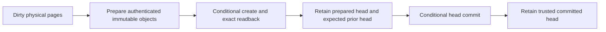

# Bootstrap trust and object delivery

The distribution fixes program/root bytes. Delivery locates and moves those
bytes, and a Supervisor decides which authenticated reference may become
current. A URL, a bucket credential, an ETag and a decryption key each have a
different job.

## Initial native release

The operator approved initial stable native publication on 2026-10-13. The
`os-length3-linux-v0.1.0` GitHub Release is the initial publisher channel. Obtain
the exact version and SHA-256 through that authenticated, independently
approved publisher account before opening a bundle or using a mirror. Retain
these pins locally. `latest`, a redirect, an adjacent checksum and an internal
public key cannot establish that initial approval by themselves.

This bootstrap uses the authenticated GitHub channel, not a detached publisher
signature. GitHub account/channel compromise remains in its trust boundary.
The existing APK public PEM is separately downloadable and installed in the
authenticated root's `package-trust` package. Its exact-file SHA-256 is
`872070838751f9ba52b49c4198277d071f91ce1a1e130e10df59a203de13271e`.
The existing local signing key is unchanged. Publishing this archive does not
establish that key as an independently provisioned production repository
authority or add an online package repository. Offline APK queries remain
available. A future repository/key transition needs an explicit trusted
policy update and operator custody; downloading a new key from a mirror is
insufficient.

The first native bundle is an approved delivery milestone with its measured
acceptance and limits. It does not mark the later canonical 75 MB release-word,
complete independent ELF semantic checker, browser cold-time target or host
launcher gates passed. Browser qualification remains a preview channel.

This follows the responsibilities described by
[Debian apt-secure](https://manpages.debian.org/bookworm/apt/apt-secure.8.en.html)
(authenticated release metadata and independently acquired keyring),
[Alpine installation](https://docs.alpinelinux.org/user-handbook/0.1a/Installing/manual.html)
(`/etc/apk/keys` and separately configured repositories), and
[Nix cache configuration](https://nix.dev/manual/nix/2.35/command-ref/conf-file.html#conf-trusted-public-keys)
(cache locations and accepted signer identities are separate configuration).
These references guide this design; they do not certify this distribution.

## Authority kept outside the bundle

| Material | Meaning | Location / lifetime |
| --- | --- | --- |
| Approved publisher and release digest | Permission to execute this exact root | Client/operator policy approved before download |
| APK private key | Permission to publish packages/indexes | Publisher custody; never a distribution or workspace payload |
| APK public key | Package signature checking within an approved policy | Public keyring package and explicit trusted policy |
| Workspace CryptoKey and volume context | Authenticate/decrypt this workspace | Approved browser origin/profile, separate from ciphertext rows |
| Trusted head and Supervisor generation | Freshness and exclusive writer fencing | Strict local authority transaction, not a storage listing |
| Operation-specific storage grant | Permission to GET/PUT one physical coordinate | Short-lived Supervisor grant; no ambient cookies |
| HTTP ETag | Conditional-write concurrency token | Storage protocol only; never a digest, signature or freshness approval |

The initial workspace is created only by an explicit new-workspace operation.
Existing unidentified ciphertext fails recovery without replacement keys or
formatting. The approved browser origin is the implemented recovery authority;
deleting its site data loses its non-extractable key/context. Portable recovery,
automatic rotation and cross-device recovery are not implemented. A public
release key must never derive a workspace secret. See
workspace authority (removed with the old web product).

## Fetch: resolve a retained reference, then admit bytes

Start from an approved immutable release digest or a retained authenticated
workspace head. Request only its required objects. Check each ciphertext
object's identity and extent, then perform the existing role/coordinate-bound
AEAD and plaintext checks before admission. A missing nonzero object is an
availability/corruption error, never an implicit hole. A storage provider may
move, delay, duplicate or omit bytes; it cannot choose a new trusted head.

Fetched bytes may be cached or evicted without changing the approved identity.
A cold retry uses the same identity. Changing a mirror URL does not change the
release, workspace key, root or grant scope. Selecting a new system root is a
separate closed-workspace operation with checkpoint and compatibility checks.

## Push: publish bodies before the reference

Objects are immutable and idempotent. `PUT If-None-Match: *` creates a new
object; an existing object is accepted only after exact digest/byte readback.
After all referenced bodies exist, advance the head using `If-Match` on the
previous strong ETag, or `If-None-Match: *` for explicit creation. The prior
head's bytes must also equal the caller's retained expectation. Competing
writers cannot silently overwrite each other. Restore publishes a new
sequence referring to retained old contents; it does not decrement freshness.

A successful upload is not a committed workspace. A timeout during head PUT
has an **unknown outcome**. Retain the exact prepared encrypted envelope and
intent, then reconcile: exact replacement means committed, exact prior means
unchanged at that observation, any other head means conflict. Retry the same
envelope under the same precondition; do not encrypt a replacement because an
acknowledgement was lost. A remote observation does not itself update the local
trusted pin. A durable cloud synchronizer must journal this intent and
coordinate its local pin before it becomes a recovery authority. That
synchronizer is not connected to the product UI in this release.

The optional `HttpCiphertextStore` (removed with the old web product) implements
bounded opaque transfers, immutable readback, strong conditional writes and
explicit uncertain-outcome reconciliation. The normal product still uses its
strict origin-local `IndexedBlockStore`. There is no implicit cloud upload,
automatic refresh, bucket listing, garbage collection or delete API.
`data/oracle/check-object-store-transport.mjs` exercises a real loopback HTTP
tier and the real encrypted `PersistentBlock`, including corruption, racing
head publication and a lost successful acknowledgement. Deployed provider
credentials, CORS and cloud durability are not qualified by that fixture.

For S3, the grant must sign the actual conditional headers and expose a strong
ETag. Browser CORS must allow required methods/headers and expose ETag;
deployment policy is explicit. Use a scoped prefix and short expiry, with
release reads separate from workspace writes.
[S3 conditional writes](https://docs.aws.amazon.com/AmazonS3/latest/userguide/conditional-writes.html)
document create/update preconditions. A provider without equivalent atomic
conditions needs a separate trusted linearizable register; GET followed by an
unconditional PUT is insufficient.

Old roots and their objects remain reachable until explicit retention/GC
policy proves no head, checkpoint or unresolved intent needs them. Delivery
and release update perform no irreversible cleanup.
